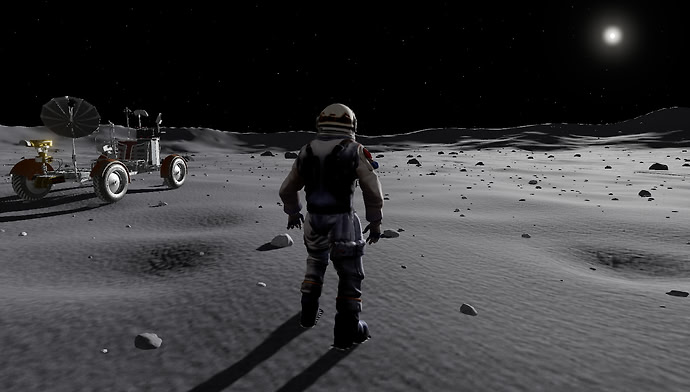

# lunar-walk

简体中文 | [English](README_EN.md)

基于 Three.js 的月面探索项目，支持宇航员漫步、跳跃、第一／第三人称切换和月球车驾驶，程序生成的地形支持连续探索。

[](https://hh-hang.github.io/lunar-walk/)

## 运行

```bash
npm install
npm run dev
```

## 操作

- WASD：移动／驾驶；Shift：奔跑／手刹；空格：跳跃／刹车。
- 鼠标：转动视角；滚轮：缩放；V：切换视角；F：上下车；靠近记录点时步行按 F 采样。
- 支持移动端触控；地址后加 `/#debug` 打开调试面板。
- 下车后在 3 处导航记录旁按 F 挖掘采样，解锁登月舱位置；再按 E 或点击登舱，观看上升级分离起飞，踏上返航之旅。

## 目录

- `src/terrain`：地貌、岩石、碎石与流式地形。
- `src/character`、`src/vehicle`：宇航员、足部 IK 与月球车。
- `src/game`：导航碎片收集与登月舱返航任务。
- `src/rendering`、`src/environment`：材质、足迹、辉光、反射与天空光照。
- `src/ui`、`src/loaders`：界面、视口适配与模型加载。
- `tests`：分类回归测试；`tools`：地形／脚印预览与性能基准。

运行 `npm test` 检查功能，`npm run bench:terrain` 检查地形 CPU 开销。开发预览位于 `/tools/terrain-preview.html` 和 `/tools/footprints-preview.html`。

## 资源来源

- [宇航员](https://sketchfab.com/3d-models/tripo-astronaut-2-stylized-and-animated-fe594ac4364942e8abad34744e507038)：Jungle Jim，[CC BY 4.0](https://creativecommons.org/licenses/by/4.0/)。
- [登月舱](https://sketchfab.com/3d-models/apollo-lunar-module-e7458d5b149b482d9829ff90ea6bc233)：jgut028，[CC BY-NC 4.0](https://creativecommons.org/licenses/by-nc/4.0/)。
- [月球车](https://sketchfab.com/3d-models/mondfahrzeug-lunar-rover-acb3f8645a69493cb211a62b40d66aab)：Deutsches Museum | Digital，[CC BY-SA 4.0](https://creativecommons.org/licenses/by-sa/4.0/)。

项目代码采用 [MIT](LICENSE) 许可；模型资源使用各自标注的许可。
