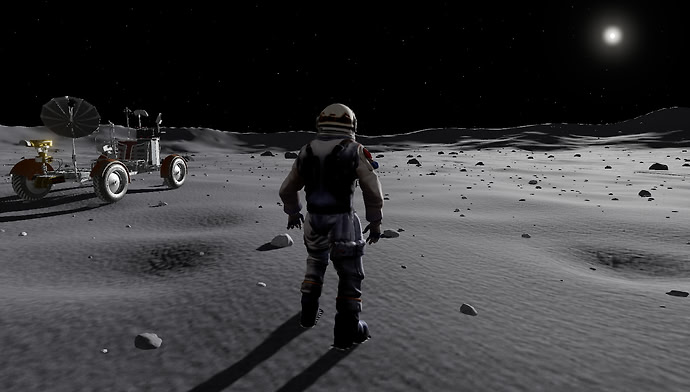

# lunar-walk

[简体中文](README.md) | English

A Three.js lunar exploration project featuring astronaut movement and jumping, first- and third-person views, and a drivable lunar rover. Procedurally generated terrain supports continuous exploration.

[](https://hh-hang.github.io/lunar-walk/)

## Run

```bash
npm install
npm run dev
```

## Controls

- WASD: move / drive; Shift: run / handbrake; Space: jump / brake.
- Mouse: look around; mouse wheel: zoom; V: switch views; F: enter / exit the rover. On foot, press F near a navigation record to collect a sample.
- Mobile touch controls are supported. Append `/#debug` to the site URL to open the debug panel.
- Exit the rover and press F beside each of the three navigation records to excavate samples and reveal the lunar module's location. Then press E or click the boarding prompt to board, watch the ascent stage separate and lift off, and begin the journey home.

## Project structure

- `src/terrain`: terrain features, rocks, gravel, and terrain streaming.
- `src/character`, `src/vehicle`: astronaut, foot IK, and lunar rover.
- `src/game`: navigation fragment collection and the lunar module return mission.
- `src/rendering`, `src/environment`: materials, footprints, bloom, reflections, and sky lighting.
- `src/ui`, `src/loaders`: interface, viewport adaptation, and model loading.
- `tests`: regression tests grouped by feature; `tools`: terrain / footprint previews and performance benchmarks.

Run `npm test` to check functionality and `npm run bench:terrain` to measure terrain CPU performance. Development previews are available at `/tools/terrain-preview.html` and `/tools/footprints-preview.html`.

## Asset credits

- [Astronaut](https://sketchfab.com/3d-models/tripo-astronaut-2-stylized-and-animated-fe594ac4364942e8abad34744e507038) by Jungle Jim, licensed under [CC BY 4.0](https://creativecommons.org/licenses/by/4.0/).
- [Lunar module](https://sketchfab.com/3d-models/apollo-lunar-module-e7458d5b149b482d9829ff90ea6bc233) by jgut028, licensed under [CC BY-NC 4.0](https://creativecommons.org/licenses/by-nc/4.0/).
- [Lunar rover](https://sketchfab.com/3d-models/mondfahrzeug-lunar-rover-acb3f8645a69493cb211a62b40d66aab) by Deutsches Museum | Digital, licensed under [CC BY-SA 4.0](https://creativecommons.org/licenses/by-sa/4.0/).

The project code is licensed under [MIT](LICENSE). Model assets are covered by their respective licenses listed above.
